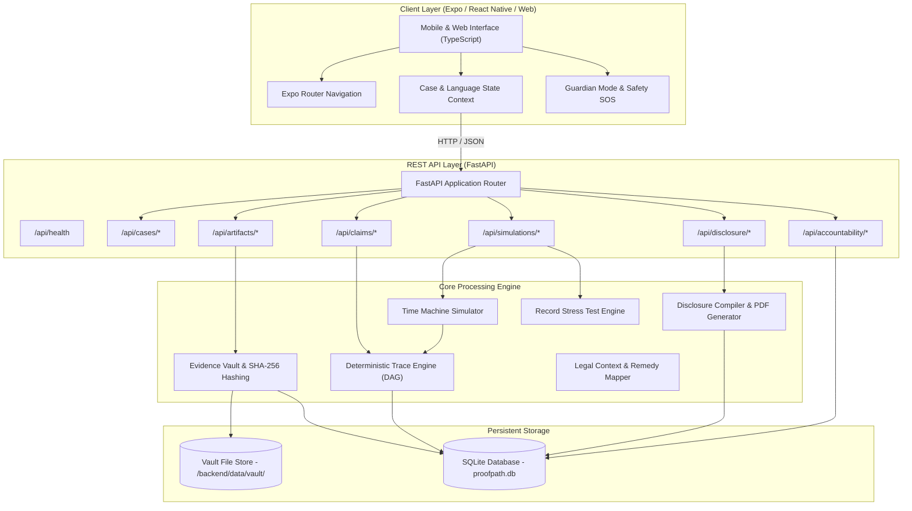
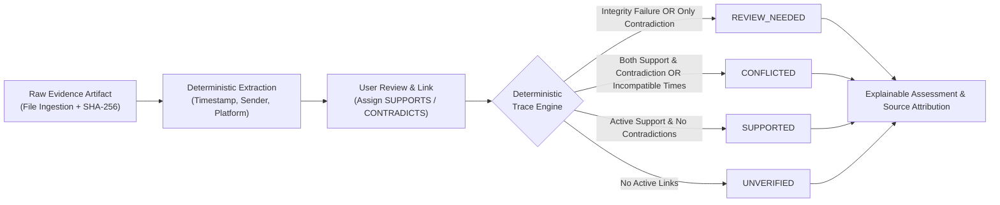
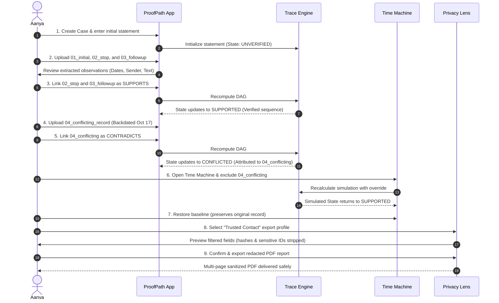

# ProofPath

> **From fragmented digital evidence to a traceable, privacy-reviewed incident record.**

[](https://www.python.org/)
[](https://fastapi.tiangolo.com/)
[](https://reactnative.dev/)
[](https://expo.dev/)
[](https://www.typescriptlang.org/)
[](backend/tests/)

ProofPath is an evidence-structuring and privacy-controlled disclosure platform designed to help individuals record, link, evaluate, and safely share documentation of repeated online harassment, stalking, and digital abuse. 

Rather than storing unorganized screenshots in camera rolls or relying on error-prone manual notes, ProofPath establishes an auditable, cryptographic evidentiary chain. It connects raw digital artifacts (text exports, messages, images, PDFs) to specific factual statements, verifies data integrity with SHA-256 hashing, checks temporal consistency, and allows counterfactual exploration without altering underlying records.

---

## Table of Contents

- [Problem Statement](#problem-statement)
- [What Makes ProofPath Different](#what-makes-proofpath-different)
- [Core Features](#core-features)
- [System Architecture](#system-architecture)
- [Evidence Reasoning Architecture](#evidence-reasoning-architecture)
- [Complete Walkthrough: Aanya's Scenario](#complete-walkthrough-aanyas-scenario)
- [Privacy and Security Model](#privacy-and-security-model)
- [Technology Stack](#technology-stack)
- [Project Directory Structure](#project-directory-structure)
- [Installation and Local Development](#installation-and-local-development)
- [Testing ProofPath on a Physical Mobile Device](#testing-proofpath-on-a-physical-mobile-device)
- [API Reference](#api-reference)
- [Testing and Validation](#testing-and-validation)
- [Known Limitations](#known-limitations)
- [Future Roadmap](#future-roadmap)
- [Responsible Use and Legal Disclaimer](#responsible-use-and-legal-disclaimer)

---

## Problem Statement

Individuals navigating digital harassment and stalking face severe operational and emotional challenges when attempting to document their experiences:

1. **Fragmented Evidence Across Silos:** Harassment frequently spans messaging apps, SMS, emails, social media, and call logs. Preserving them as raw, disconnected screenshots leads to chronological confusion and missing context.
2. **Fragile Evidentiary Trails:** Files moved across devices or uploaded to chat apps lose metadata, risk accidental modification, or lack cryptographic proof of preservation.
3. **Ambiguous and Contradictory Records:** Attackers often manipulate timestamps, delete messages, or send conflicting signals. Without structured cross-examination, survivors struggle to reconcile discrepancies or understand evidentiary gaps.
4. **All-or-Nothing Disclosure Risk:** When seeking support from friends, counselors, or employers, victims often have no way to share contextual summaries without inadvertently exposing sensitive personal details (e.g., home addresses, phone numbers, medical mentions, or confidential docket numbers).
5. **Lack of Follow-up Accountability:** After filing complaints or seeking help, tracking formal reference numbers, dates, officer interactions, and required next steps becomes overwhelming during trauma.

ProofPath addresses these challenges by replacing chaotic folders with a structured, verified Directed Acyclic Graph (DAG) linking facts to claims with recipient-aware privacy filters.

---

## What Makes ProofPath Different

ProofPath connects the complete evidentiary lifecycle into a unified, transparent pipeline:

$$\textbf{Capture} \longrightarrow \textbf{Trace} \longrightarrow \textbf{Test} \longrightarrow \textbf{Protect} \longrightarrow \textbf{Act}$$

### 1. Traceable Evidence Relationships
Unlike standard gallery apps or generic notes, ProofPath does not treat evidence as isolated files. Every piece of ingested evidence is tied to atomic *Observations* (extracted facts), which are explicitly linked to *Claims* (factual statements) as supporting or contradictory relations.

### 2. Deterministic and Explainable Assessments
ProofPath avoids non-deterministic or hallucination-prone AI for legal assessments. Claims are evaluated through an algorithmic rule engine using strict precedence logic. Every status (`SUPPORTED`, `CONFLICTED`, `UNVERIFIED`, `REVIEW_NEEDED`) includes an unambiguous, verifiable explanation pointing directly to the source artifacts.

### 3. Transparent Contradictions
When timestamps or records conflict (e.g., two logs claiming an event occurred at different times, or an explicit denial), ProofPath surfaces the conflict immediately rather than ignoring it or guessing.

### 4. Reversible Counterfactual Analysis (Time Machine)
Users can test the fragility of their record using the **Time Machine**. By temporarily toggling evidence sources or observations on or off, users see how their case holds up under scrutiny—without modifying, deleting, or compromising the original underlying files.

### 5. Recipient-Specific Disclosure (Privacy Lens)
Before sharing an incident summary, ProofPath filters data using strict server-side allowlists tailored for specific audiences (Trusted Contacts, Support Organizations, or Legal Counsel), preventing unintended privacy leaks.

### 6. Actionable Next Steps and Accountability
ProofPath integrates statutory legal context, remedies, institutional accountability tracking, and discreet safety tools into a cohesive experience.

---

## Core Features

### 1. Evidence Vault
- **Purpose:** Securely ingests and registers digital files (screenshots, text files, PDF exports).
- **Technical Behavior:** Computes SHA-256 cryptographic hashes immediately upon receipt. Rejects duplicate identical uploads (`409 Conflict`) to prevent record inflation and verifies hash matches on retrieval.
- **User Benefit:** Establishes an immutable record of digital artifacts from day one.

### 2. Observation Review and Linking
- **Purpose:** Bridges raw documents to specific claims.
- **Technical Behavior:** Deterministically extracts key parameters (dates, senders, platforms, message snippets) from ingested text artifacts. Users review proposed facts, adjust them if necessary, and assign relationships (`SUPPORTS` or `CONTRADICTS`) to specific statements.
- **User Benefit:** Eliminates confusion over what each piece of evidence actually demonstrates.

### 3. Deterministic Trace Engine
- **Purpose:** Computes the evidentiary standing of each claim.
- **Technical Behavior:** Applies strict deterministic precedence rules across the claim-evidence DAG:
  1. `REVIEW_NEEDED`: Integrity failure detected (tampered SHA-256 or missing file), OR only contradictory observations exist.
  2. `CONFLICTED`: Both supporting and contradictory evidence exist, or structured timestamp conflicts are present across active sources.
  3. `SUPPORTED`: Active supporting observations exist with zero active contradictions or integrity faults.
  4. `UNVERIFIED`: No active supporting or contradictory links exist.
- **User Benefit:** Provides clear, explainable feedback on where the record is solid and where documentation is lacking.

### 4. Evidence Time Machine
- **Purpose:** Counterfactual "what-if" scenario simulation.
- **Technical Behavior:** Accepts non-destructive overrides to simulate the exclusion of specific artifacts or observations. Recomputes claim states in real time entirely in memory, leaving disk records and hashes untouched.
- **User Benefit:** Allows survivors and advocates to see what happens if an adversary challenges or discredits a specific piece of evidence.

### 5. Record Stress Test
- **Purpose:** Evaluates overall case readiness and evidentiary resilience.
- **Technical Behavior:** Analyzes single-source dependencies, unresolved conflicts, missing dates, unbacked claims, and unsupported statements across the entire incident.
- **User Benefit:** Flags vulnerabilities before a report is shared with external authorities or attorneys.

### 6. Privacy Lens and Disclosure Compiler
- **Purpose:** Recipient-aware report generation.
- **Technical Behavior:** Enforces strict server-side allowlists matching recipient clearance tiers:
  - **Trusted Contact:** Summary categories, claim text, and verification states. Sensitive identifiers, raw SHA-256 hashes, exact timestamps, and police docket numbers are stripped.
  - **Support Organization:** Contextual timeline, incident dates, claim text, observation counts, and high-level support status. Raw forensic hashes and agency reference numbers remain withheld.
  - **Legal Professional:** Formal evidentiary timeline, exact timestamps, observation details, cryptographic SHA-256 proofs, link relationships, and formal accountability trail dockets.
- **User Benefit:** Eliminates oversharing and safeguards personal privacy when seeking help.

### 7. PDF Incident Reports
- **Purpose:** Compiles clean, printable multi-page disclosure documents.
- **Technical Behavior:** Built using ReportLab flowable layouts. Requires explicit user confirmation of settings (`confirmed_config: true`) and scans compiled output to ensure no prohibited fields appear in document text or metadata. Excludes raw image attachments to prevent forensic visual leakage.
- **User Benefit:** Generates professional documentation ready for legal intake or personal archival.

### 8. Incident Dashboard and Timeline
- **Purpose:** Unified overview of case progress.
- **Technical Behavior:** Visualizes the chronological sequence of confirmed facts, unverified statements, active evidence count, and overall verification scores.
- **User Benefit:** Replaces fragmented notes with a clear, organized chronology.

### 9. Accountability Trail
- **Purpose:** Tracks external institutional interactions and follow-ups.
- **Technical Behavior:** Append-only logging of reports filed with police, cyber cells, platform helpdesks, or counselors. Stores reference numbers, officer notes, and next follow-up dates while tracking whether each entry is backed by documentation.
- **User Benefit:** Ensures vital incident report numbers and deadlines are never misplaced.

### 10. Legal Context and Remedies
- **Purpose:** Clarifies legal rights under applicable statutory frameworks (such as the Bharatiya Nyaya Sanhita / Information Technology Act).
- **Technical Behavior:** Maps specific recorded incident types (e.g., cyberstalking, harassment, extortion) to relevant statutory provisions, available protective remedies, and recommended procedural steps.
- **User Benefit:** Demystifies complex legal procedures for non-lawyers.

### 11. Support and Next-Step Navigator
- **Purpose:** Guides users through structured safety and reporting options.
- **Technical Behavior:** Evaluates current case state (e.g., whether emergency threats exist, whether evidence is sufficient) and suggests immediate, medium-term, and long-term actions.
- **User Benefit:** Reduces cognitive load during high-stress situations.

### 12. Guardian Mode
- **Purpose:** Discreet privacy and quick exit for physical safety.
- **Technical Behavior:** One-tap toggle that masks the UI into an innocuous utility or neutral reading screen, immediately hiding sensitive evidence from shoulder surfers or coercive partners.
- **User Benefit:** Protects users from in-person detection when reviewing evidence in public or shared spaces.

### 13. Multilingual Interface
- **Purpose:** Broad linguistic accessibility across diverse communities.
- **Technical Behavior:** Full internationalization architecture supporting English, Hindi (हिन्दी), and Marathi (मराठी) across all UI elements and status badges.
- **User Benefit:** Empowers users to navigate sensitive safety tools in their primary language.

---

## System Architecture

ProofPath is designed with a decoupled architecture: a cross-platform mobile client built on React Native / Expo, communicating via REST with a lightweight, high-performance Python FastAPI backend backed by SQLite.



> **Design Rationale:** React Native with Expo was selected to accelerate cross-platform MVP delivery across mobile devices and desktop browsers. The backend uses Python and FastAPI for fast cryptographic hashing, ReportLab PDF rendering, and deterministic graph analysis. SQLite provides zero-configuration local persistence suitable for rapid evaluation, with clean repository abstraction for production database upgrades.

---

## Evidence Reasoning Architecture

ProofPath evaluates factual statements through a deterministic Directed Acyclic Graph (DAG) connecting raw evidence files to claims.



### Claim State Precedence Rules

| Precedence | Claim State | Condition | Deterministic Reason Provided |
|:---:|:---|:---|:---|
| **1 (Highest)** | `REVIEW_NEEDED` | Cryptographic SHA-256 hash mismatch, missing source file, or only contradictory observations exist with zero supporting evidence. | Explicit notice of integrity problem or unbacked contradiction requiring review. |
| **2** | `CONFLICTED` | Both active supporting and contradictory observations exist, or active supporting sources have irreconcilable timestamp discrepancies. | Explicit citation of the conflicting evidence records and timestamps. |
| **3** | `SUPPORTED` | One or more active supporting observations exist with zero active contradictions or integrity faults. | Cites the count and IDs of supporting observations. |
| **4 (Lowest)** | `UNVERIFIED` | Zero active evidence observations are linked to the statement (or all supporting links were excluded in simulation). | Advises that the statement currently lacks backing evidence. |

*Important Clarification:* ProofPath evaluates recorded relationships established by the user and verified by deterministic rules. It does not unilaterally prove forensic authenticity or claim automated detection of all possible real-world contradictions.

---

## Complete Walkthrough: Aanya's Scenario

To illustrate the complete workflow, consider the following real-world scenario:

### The Scenario
**Aanya** has been receiving persistent, unwanted messages from an unknown contact. She explicitly asked the sender to stop, but the sender continued contacting her.

She adds the central claim to ProofPath:
> *"The sender continued contacting Aanya after she asked them to stop."*

### Synthetic Evidence Set
1. `01_initial_message.txt` (Oct 18, 2026, 10:15 AM): Sender asks: *"Why are you ignoring me? Reply."*
2. `02_stop_request.txt` (Oct 18, 2026, 10:20 AM): Aanya replies: *"Please do not contact me again. I do not want to speak with you."*
3. `03_followup_message.txt` (Oct 19, 2026, 08:40 PM): Sender contacts her again: *"Blocking me won't stop me from contacting you."*
4. `04_conflicting_record.txt` (Oct 17, 2026, 08:40 PM): A duplicate log entry with a backdated timestamp (claiming the follow-up occurred *before* the stop request).

### End-to-End User Journey



---

## Privacy and Security Model

ProofPath treats user privacy as an active engineering control rather than a policy disclaimer:

### 1. Evidence Preservation and Cryptographic Hashing
- Ingested files are stored in an isolated vault directory.
- SHA-256 hashes are computed on ingestion and checked upon retrieval to ensure files are never modified after storage.
- Duplicate identical uploads are detected via hash matching and rejected with HTTP `409 Conflict`.

### 2. Strict Server-Side Allowlists
Data redaction is never performed purely in client-side CSS or UI toggles. The FastAPI backend enforces strict server-side allowlists before data is assembled for preview or PDF compilation:

```
[Client Request] ──> [Server Allowlist Filter] ──> [PDF Generator] ──> [Sanitized Document]
```

- **Trusted Contact:** Internal database IDs, raw SHA-256 hashes, exact timestamps, and police docket numbers are completely stripped.
- **Support Organization:** Retains date context and observation summaries, withholding raw forensic proofs and sensitive reference numbers.
- **Legal Professional:** Generates a formal evidentiary disclosure including cryptographic hashes, full timeline, and linked accountability provenance.

### 3. Explicit Confirmation Required
Unconfirmed export requests (`confirmed_config: false`) are rejected with HTTP `400 Bad Request`. Users must explicitly inspect and confirm the privacy preview before a PDF is compiled.

### 4. Cross-Case Isolation
Strict case boundary validation prevents cross-case linking or evidence retrieval. Attempts to reference an artifact from another case return HTTP `403/404`.

### 5. Clear Boundaries
- ProofPath does not claim to provide complete anonymity, nor does it guarantee the admissibility of evidence in any specific court.
- Hashing verifies data integrity against alteration; it does not independently verify the authenticity of real-world events.

---

## Technology Stack

| Layer | Technology | Purpose | Selection Rationale |
|:---|:---|:---|:---|
| **Mobile & Web UI** | React Native / Expo | Cross-platform frontend application | Enables simultaneous mobile and web support from a single TypeScript codebase. |
| **Routing** | Expo Router | File-based navigation | Clean, modular page structure with native navigation conventions. |
| **Language** | TypeScript 5.0+ | Type-safe application development | Ensures compile-time safety across complex evidence models and state. |
| **Backend API** | Python 3.10+ / FastAPI | High-performance REST service | Native async handling, automatic schema validation, and fast cryptographic operations. |
| **Evidence Reasoning** | Deterministic DAG Engine | Claim-evidence evaluation | Non-hallucinatory, explainable, and fully auditable decision logic. |
| **Integrity** | SHA-256 (hashlib) | Tamper-evident record hashing | Standard, collision-resistant cryptographic hash for file integrity. |
| **Document Generation** | ReportLab 4.0+ | Flowable multi-page PDF compilation | Precise programmatic layout control with strict field allowlist filtering. |
| **PDF Inspection** | pypdf | PDF text & metadata validation | Used in adversarial privacy testing to verify zero data leakage in generated files. |
| **Database** | SQLite 3 | Relational metadata persistence | Lightweight, self-contained, and requires zero external database dependencies for local setups. |
| **Testing** | Pytest / AnyIO | Comprehensive test automation | Flexible test framework covering unit, integration, and security test suites. |

---

## Project Directory Structure

```text
ProofPATH/
├── backend/
│   ├── app/
│   │   ├── __init__.py
│   │   ├── accountability.py     # Institutional follow-up & docket logging
│   │   ├── compiler.py           # Recipient allowlists & PDF generation
│   │   ├── db.py                 # SQLite initialization & database queries
│   │   ├── fixture.py            # Synthetic demo data fixtures
│   │   ├── legal_mapper.py       # Statutory context & remedies mapper
│   │   ├── main.py               # FastAPI routes & HTTP handlers
│   │   ├── navigator.py          # Next-step decision support engine
│   │   ├── remedies.py           # Legal remedies & safety guidance
│   │   ├── stress_test.py        # Case resilience & single-source auditor
│   │   ├── trace_engine.py       # Deterministic DAG claim state engine
│   │   └── vault.py              # File ingestion & SHA-256 verification
│   ├── data/
│   │   └── vault/                # Secure file storage (.gitkeep preserved)
│   ├── tests/
│   │   ├── test_accountability_trail.py
│   │   ├── test_adversarial_privacy.py      # P0 privacy leak validation
│   │   ├── test_backend.py                  # Core backend endpoints
│   │   ├── test_comparative_benchmark.py    # 15-scenario technical benchmark
│   │   ├── test_evidence_workflow.py        # Ingestion & linking lifecycle
│   │   ├── test_failure_modes.py            # Negative path resilience tests
│   │   ├── test_guardian_mode.py            # Safety disguise logic
│   │   ├── test_legal_context_mapper.py     # Statutory mappings
│   │   ├── test_localization.py             # Language support verification
│   │   ├── test_next_step_navigator.py      # Support recommendations
│   │   ├── test_pdf_export_regression.py    # PDF layout & filtering
│   │   ├── test_remedies.py                 # Remedies endpoints
│   │   └── test_sprint5_verification.py     # End-to-end integration tests
│   ├── pytest.ini
│   └── requirements.txt          # Python dependencies
├── mobile/
│   ├── src/
│   │   ├── app/                  # Expo Router screens
│   │   │   ├── _layout.tsx       # Root layout & navigation providers
│   │   │   ├── index.tsx         # Incident Dashboard & Case Summary
│   │   │   ├── evidence.tsx      # Evidence Vault & Observation Review
│   │   │   ├── time-machine.tsx  # Counterfactual Scenario Simulator
│   │   │   ├── privacy.tsx       # Share Safely & PDF Export Preview
│   │   │   ├── accountability.tsx# Follow-up Tracker & Docket Log
│   │   │   ├── guardian.tsx      # Guardian Mode quick-disguise screen
│   │   │   ├── support.tsx       # Next-Step Navigator & Resources
│   │   │   ├── stress-test.tsx   # Record Stress Test audit screen
│   │   │   ├── claim/[id].tsx    # Statement Detail & Linking View
│   │   │   └── incident/[id].tsx # Incident Detail View
│   │   ├── components/           # Reusable UI widgets & status badges
│   │   ├── context/              # CaseContext & LanguageContext
│   │   ├── i18n/                 # Localization (en, hi, mr)
│   │   ├── services/             # API clients & data transformers
│   │   └── types/                # TypeScript interfaces & enums
│   ├── app.json                  # Expo application configuration
│   ├── package.json              # Frontend npm dependencies
│   └── tsconfig.json             # TypeScript configuration
├── .gitignore
├── API_CONTRACT.md               # API schema & contract specification
└── README.md                     # Complete product documentation
```

---

## Installation and Local Development

### Prerequisites
- **Python:** 3.10 or higher
- **Node.js:** 18.0 or higher (with `npm`)
- **Git**

### 1. Clone the Repository
```bash
git clone https://github.com/bh00mi-11/ProofPATH.git
cd ProofPATH
```

### 2. Backend Setup

#### On Windows (PowerShell):
```powershell
cd backend
python -m venv .venv
.\.venv\Scripts\Activate.ps1
pip install -r requirements.txt
```

#### On Linux / macOS:
```bash
cd backend
python3 -m venv .venv
source .venv/bin/activate
pip install -r requirements.txt
```

#### Start the FastAPI Server:
```bash
python -m uvicorn app.main:app --host 127.0.0.1 --port 8000 --reload
```
*Verify backend health by opening `http://127.0.0.1:8000/api/health`.*

### 3. Frontend Setup

In a new terminal window:
```bash
cd mobile
npm install
```

#### Start Expo Web Development:
```bash
npm run web
```
The application will launch in your browser at `http://localhost:8081`.

---

## Testing ProofPath on a Physical Mobile Device

### Running ProofPath on Your Phone (Local Network)

To run the application on a real mobile device, both your development laptop and your phone must be connected to the **same local Wi-Fi network**.

```
[ Development Laptop ] ──────── (Same Wi-Fi Network) ──────── [ Physical Phone ]
  Runs FastAPI (:8000)                                          Runs Expo Web / Expo App
  Runs Expo (:8081)
```

#### Step 1 — Find Your Laptop's Local IP Address
- **On Windows (PowerShell):**
  ```powershell
  ipconfig
  ```
  Locate your active Wi-Fi adapter's **IPv4 Address** (e.g., `192.168.1.105`).
- **On macOS / Linux:**
  ```bash
  ifconfig | grep "inet " | grep -v 127.0.0.1
  ```

#### Step 2 — Start FastAPI Bound to All Interfaces
Start the backend bound to `0.0.0.0` so it accepts connections from other devices on your local network:
```bash
cd backend
python -m uvicorn app.main:app --host 0.0.0.0 --port 8000
```
*(Note: `0.0.0.0` tells the server to bind to all network adapters; your phone will connect to your laptop's specific LAN IP).*

#### Step 3 — Configure the Frontend API URL
The mobile app reads its backend target from `EXPO_PUBLIC_API_BASE_URL`.

Create or edit `mobile/.env`:
```env
EXPO_PUBLIC_API_BASE_URL=http://192.168.1.105:8000
```
*(Replace `192.168.1.105` with your laptop's actual IPv4 address).*

#### Step 4 — Start Expo
```bash
cd mobile
npx expo start --clear
```
- **Web on Mobile Browser:** You can directly open `http://192.168.1.105:8081` in Chrome or Safari on your phone.
- **Expo Go App:** Scan the QR code displayed in your terminal using the Expo Go app (Android) or Camera app (iOS).

#### Step 5 — Verify Connectivity
On your phone's browser, test the backend directly:
```text
http://192.168.1.105:8000/api/health
```
If this returns `{"status": "ok", "service": "ProofPath Backend"}`, your network connection is operating correctly.

#### Mobile Troubleshooting Tips
- **Windows Firewall:** If your phone cannot connect, verify that Windows Defender Firewall allows incoming connections on port `8000` for **Private Networks**.
- **AP Isolation:** Public, guest, or university Wi-Fi networks often enable "Client Isolation," preventing devices from seeing each other. If this occurs, test using a personal phone hotspot.
- **Restart Expo:** Always restart your Expo server with `--clear` after modifying `.env` variables.

---

## API Reference

The FastAPI backend exposes the following REST endpoints:

### Health & System
| Method | Path | Description |
|:---|:---|:---|
| `GET` | `/api/health` | Service health check and status. |

### Case Management
| Method | Path | Description |
|:---|:---|:---|
| `POST` | `/api/cases` | Initializes a new incident case record with optional initial claim. |
| `GET` | `/api/cases/{case_id}` | Retrieves full case details, claims, and linked artifacts. |

### Evidence Vault
| Method | Path | Description |
|:---|:---|:---|
| `POST` | `/api/artifacts/upload?case_id={id}` | Ingests a digital file, computes SHA-256, and checks deduplication. |
| `GET` | `/api/artifacts/{id}/content?case_id={id}` | Returns verified file content and cryptographic integrity status. |
| `GET` | `/api/artifacts/{id}/proposals?case_id={id}` | Deterministically extracts facts from the uploaded document. |

### Claims & Trace Engine
| Method | Path | Description |
|:---|:---|:---|
| `POST` | `/api/claims/link?case_id={id}` | Links an extracted observation to a claim (`SUPPORTS` or `CONTRADICTS`). |
| `GET` | `/api/claims/{claim_id}/trace?case_id={id}` | Evaluates claim standing and returns deterministic explanation. |

### Time Machine & Simulation
| Method | Path | Description |
|:---|:---|:---|
| `POST` | `/api/simulations/recompute` | Accepts counterfactual overrides and simulates claim states in-memory. |
| `GET` | `/api/cases/{id}/stress-test` | Analyzes evidence fragility and flags unbacked or conflicting claims. |

### Privacy Lens & PDF Export
| Method | Path | Description |
|:---|:---|:---|
| `POST` | `/api/disclosure/preview` | Returns server-side allowlisted preview for a specified recipient profile. |
| `POST` | `/api/export/pdf` | Compiles a privacy-filtered PDF report (requires `confirmed_config: true`). |

### Accountability & Legal Context
| Method | Path | Description |
|:---|:---|:---|
| `POST` | `/api/cases/{id}/accountability/entries`| Logs a formal institutional action (police complaint, platform ticket). |
| `GET` | `/api/cases/{id}/accountability` | Retrieves the append-only institutional accountability timeline. |
| `GET` | `/api/legal-context/{category}` | Returns statutory provisions and legal remedies for an incident type. |
| `GET` | `/api/navigator/next-steps?case_id={id}`| Returns dynamic recommendations based on case readiness. |

*Interactive Swagger documentation is available at `http://localhost:8000/docs` when running in development.*

---

## Testing and Validation

ProofPath includes an extensive test suite covering core logic, cryptographic validation, privacy leak prevention, and negative edge cases.

### Running Backend Tests
From the `backend/` directory:
```bash
pytest -v
```

### Verified Test Results
```text
============================= test session starts =============================
platform win32 -- Python 3.13.9, pytest-9.1.1
collected 69 items

tests/test_accountability_trail.py .......                               [ 10%]
tests/test_adversarial_privacy.py .                                      [ 11%]
tests/test_backend.py ......................                             [ 43%]
tests/test_comparative_benchmark.py .                                    [ 44%]
tests/test_evidence_workflow.py .                                        [ 46%]
tests/test_failure_modes.py .                                            [ 47%]
tests/test_guardian_mode.py ..                                           [ 50%]
tests/test_legal_context_mapper.py ......                                [ 59%]
tests/test_localization.py ...                                           [ 63%]
tests/test_next_step_navigator.py ......                                 [ 72%]
tests/test_pdf_export_regression.py .......                              [ 82%]
tests/test_remedies.py ....                                              [ 88%]
tests/test_sprint5_verification.py ........                              [100%]

============================= 69 passed in 14.73s =============================
```

### Running Frontend Typechecks
From the `mobile/` directory:
```bash
npx tsc --noEmit
```
*Result: Clean compilation with 0 type errors.*

### Benchmark Summary (Comparative Evaluation)
Evaluated across 15 synthetic test scenarios comparing ProofPath's Deterministic Trace Engine with a standard flat chronological timeline:
- **Relationship Attribution:** ProofPath 19/19 (100%) vs Baseline 0/19 (0% — baseline lacks a claim DAG).
- **Contradiction Surfacing:** ProofPath 5/5 (100%) vs Baseline 0/5 (0% — baseline lacks conflict resolution logic).
- **False Contradiction Rate:** 0.0% (Zero false alerts generated).
- **Unsupported Claim Detection:** ProofPath 4/4 (100%) vs Baseline 0/4 (0% — baseline cannot identify unbacked claims).

---

## Known Limitations

While ProofPath provides robust evidence structuring, users and developers should be aware of current MVP boundaries:

1. **Deterministic Text Extraction Scope:** Automated fact extraction is optimized for structured message exports, chat logs, and plain text. Handwritten documents or low-resolution images require user review and manual transcription.
2. **User-Guided Relationship Assignment:** The system relies on the user to review proposed facts and link them as supporting or contradictory. It does not replace human judgment.
3. **No Independent Authenticity Guarantee:** SHA-256 cryptographic hashing guarantees *tamper-evidence* (the file has not been altered since ingestion); it does not prove that the underlying events in the screenshots actually occurred.
4. **Court Admissibility Varies:** While ProofPath follows sound evidentiary principles (hash integrity, clear provenance, non-destructive simulation), formal legal admissibility depends on local jurisdictional statutes (e.g., Section 65B of the Indian Evidence Act / Section 63 of the BSA) and judicial discretion.
5. **No Automatic Emergency Dispatch:** ProofPath is a documentation tool. Triggering SOS opens dialer shortcuts (`112`) but does not automatically dispatch law enforcement.

---

## Future Roadmap

The following improvements are planned for future production versions:

- [ ] **Multi-Format OCR Pipeline:** Integrating local, privacy-preserving OCR for automated fact extraction from screenshots.
- [ ] **Cryptographic Signing (Ed25519):** Adding hardware-backed cryptographic signatures to seal case archives at specific points in time.
- [ ] **End-to-End Encrypted Sync:** Supporting zero-knowledge encrypted cloud backups using client-side encryption keys.
- [ ] **Decentralized Time-Stamping:** Anchoring case archive hashes to public ledgers or certified RFC 3161 timestamp authorities.
- [ ] **Native Screen-Reader Optimization:** Enhancing VoiceOver and TalkBack auditory labels across the mobile application.

---

## Responsible Use and Legal Disclaimer

ProofPath is designed to empower individuals with structured record-keeping, decision support, and privacy-reviewed sharing.

> **CRITICAL NOTICE:** ProofPath is **not a replacement for legal counsel, formal law enforcement investigation, or emergency services**. If you are in immediate physical danger, contact your local emergency services (112 in India, 911 in the US) or a certified crisis hotline immediately.
