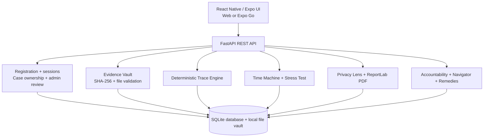
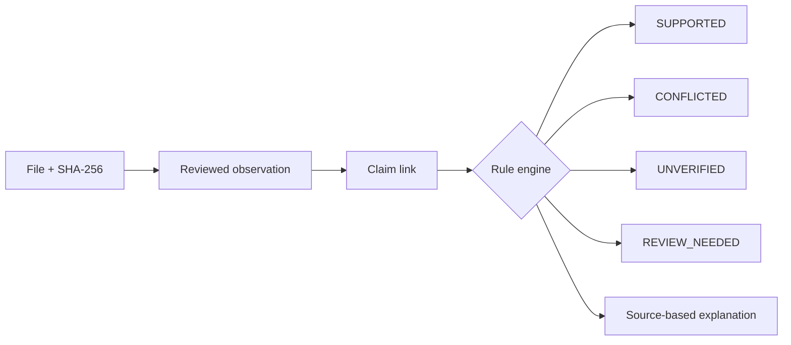
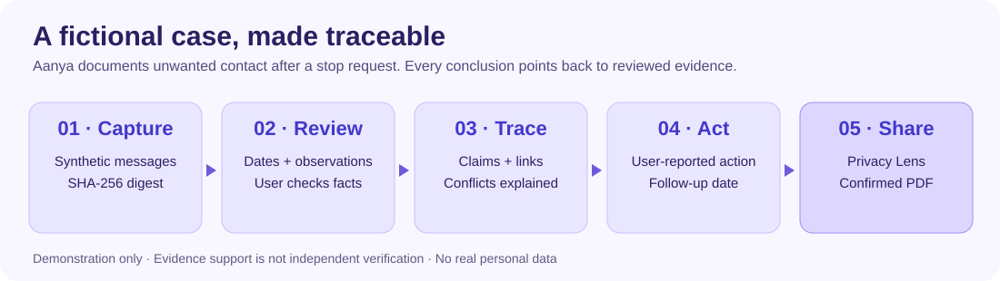
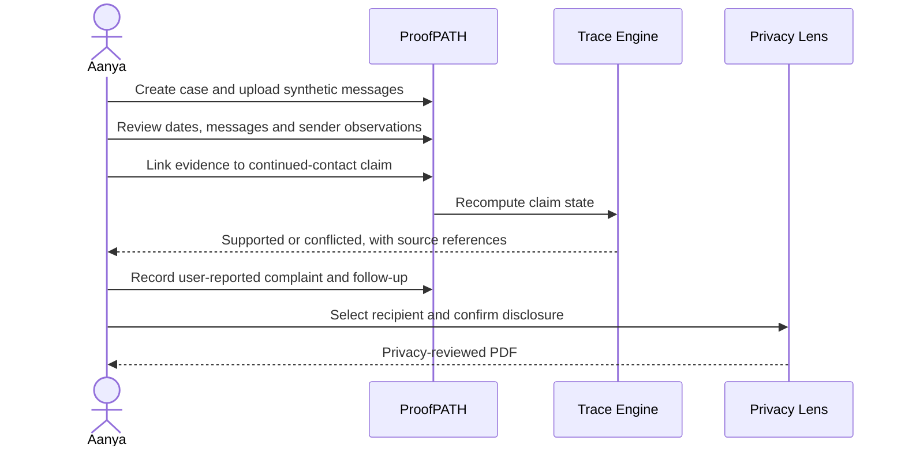

# ProofPATH

**From fragmented digital evidence to traceable, privacy-reviewed incident records.**

ProofPATH is a local-first prototype for documenting online harassment, stalking and digital abuse. It links evidence to user-reviewed observations and claims, surfaces contradictions without guessing, records follow-up actions and creates recipient-aware PDF reports. **An evidence-backed claim is not independently verified truth.**

## Contents

1. [Features](#features)
2. [Architecture](#architecture)
3. [Example scenario](#example-scenario)
4. [Run locally](#run-locally)
5. [Authentication and admin](#authentication-and-admin)
6. [Testing and limitations](#testing-and-limitations)

**Workflow:** Capture → Review → Trace → Challenge → Protect → Act. The deterministic engine explains source support and contradictions; it does not certify truth.

## Features

| Module | MVP behavior |
| --- | --- |
| Login and case access | Register, sign in, use expiring server-side sessions and work with owner-scoped cases (prototype) |
| Evidence Vault | Upload files, record metadata and SHA-256 digests, detect duplicates within a case |
| Observation Review | Propose observations from supported text formats; manually review or add facts |
| Trace Engine | Link observations to claims as SUPPORTS or CONTRADICTS; explain computed states |
| Evidence Timeline | Display incident records, artifacts and claim relationships |
| Time Machine | Simulate removing/disputing evidence without changing the original record |
| Stress Test | Identify missing support, contradictions and single-source dependencies |
| Privacy Lens | Preview recipient-specific disclosure fields and redact selected terms |
| PDF Export | Generate recipient-reviewed PDFs; web download and Expo Go native share/save workflow |
| Accountability Trail | Record user-reported actions, references, attachments and follow-ups; admin review with attributed Verify/Reject decisions and append-only decision history |
| Remedies and Navigator | Offer informational legal context and practical next steps |
| Guardian / Safety | Prototype quick-disguise and SOS-oriented interaction, not emergency dispatch |
| Languages | MVP English, Hindi and Marathi interface support |

## Architecture



**Stack:** React Native, Expo Router, TypeScript, Python, FastAPI, SQLite, ReportLab, Pytest. SQLite is the current database. The diagram shows **local MVP operation**, not a production hosting or security architecture.

### Evidence processing



## Example scenario




*Aanya (fictional) receives repeated unwanted messages after asking the sender to stop.*



**Example accountability entry:** “Complaint submitted on 20 October; reference ABC-123; response pending; follow-up due 27 October.” This is **user-reported** unless a separate authorized verification process confirms it.

## Run locally

**Backend** (Python 3.10+):

```bash
cd backend
python -m venv .venv
# Activate .venv for your OS
pip install -r requirements.txt
python -m uvicorn app.main:app --host 0.0.0.0 --port 8000
```

**Frontend** (Node.js 18+), in another terminal:

```bash
cd mobile
npm install
npx expo install expo-file-system expo-sharing
npx expo start --clear --lan
```

Before starting Expo, create `mobile/.env` with `EXPO_PUBLIC_API_BASE_URL=http://YOUR_LAPTOP_LAN_IP:8000` (find the laptop's IPv4 address with `ipconfig` on Windows). Keep laptop and phone on the same Wi-Fi, then scan the QR code in **Expo Go**. For browser preview, run `npm run web` instead.

## Authentication and admin

1. Register a user in the Expo app with an email and password of at least 12 characters, then sign in.
2. To create a local admin, register a second account and run from `backend/`:

   ```bash
   # macOS / Linux
   PROOFPATH_ADMIN_PROVISION=1 python -m app.provision_admin admin@example.com
   # Windows PowerShell
   $env:PROOFPATH_ADMIN_PROVISION='1'; python -m app.provision_admin admin@example.com
   ```

3. Sign in with the admin account to view pending user-reported accountability entries, record a reason and choose Verify or Reject. This means **internal admin review only**, not confirmation by police or a platform.
4. The admin decision is an **internal review**, not independent police, platform or institutional confirmation. Admin access is provisioned explicitly through the local command, not by public self-registration.

## Testing and limitations

```bash
cd backend && pytest -v
cd ../mobile && npx tsc --noEmit
```

**Demo path:** Register → Create your own case → Add synthetic evidence → Review claims → Stress Test / Time Machine → Privacy Lens → Confirm and export PDF → Record an accountability follow-up.

**Limitations:** Authentication and admin review are MVP implementations, not a completed security audit. Cross-user authorization needs security regression tests, and native PDF sharing needs device-level validation. SQLite/local files are for a controlled demo. SHA-256 checks file integrity, not authenticity; admin review does not independently verify events. This is not emergency response or legal advice. **Use fictional data only.**
