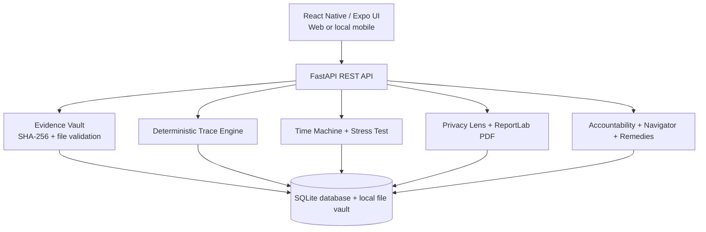
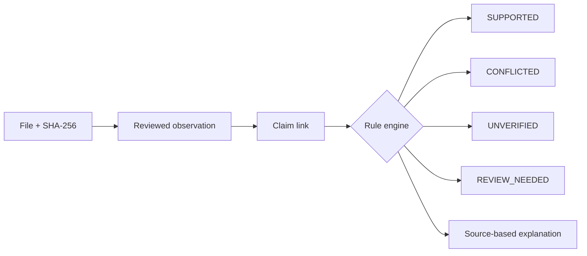
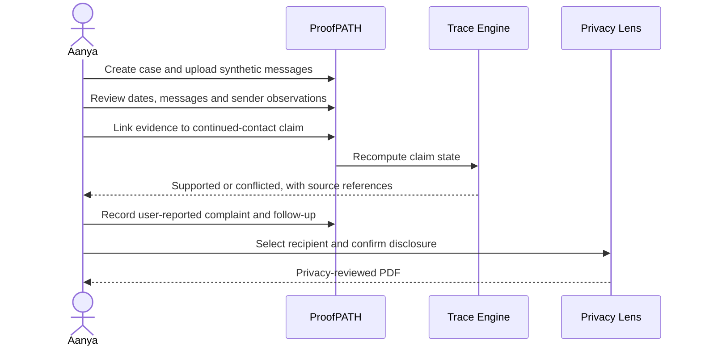

# ProofPATH

**From fragmented digital evidence to traceable, privacy-reviewed incident records.**

ProofPATH is a local-first prototype for documenting online harassment, stalking and digital abuse. It links evidence to user-reviewed observations and claims, surfaces contradictions without guessing, records follow-up actions and creates recipient-aware PDF reports. **An evidence-backed claim is not independently verified truth.**

## Contents

1. [Problem and approach](#problem-and-approach)
2. [Features](#features)
3. [Architecture](#architecture)
4. [Example scenario](#example-scenario)
5. [Local setup](#local-setup)
6. [Testing](#testing)
7. [Security and limitations](#security-and-limitations)
8. [Roadmap](#roadmap)

## Problem and approach

Digital abuse evidence is often scattered across screenshots, messages, logs and documents. ProofPATH provides a structured workflow: **Capture → Review → Trace → Challenge → Protect → Act**. Instead of an opaque AI verdict, its deterministic trace engine records why each claim is supported, conflicted, unverified or needs review.

## Features

| Module | MVP behavior |
| --- | --- |
| Evidence Vault | Upload files, record metadata and SHA-256 digests, detect duplicates within a case |
| Observation Review | Propose observations from supported text formats; manually review or add facts |
| Trace Engine | Link observations to claims as SUPPORTS or CONTRADICTS; explain computed states |
| Evidence Timeline | Display incident records, artifacts and claim relationships |
| Time Machine | Simulate removing/disputing evidence without changing the original record |
| Stress Test | Identify missing support, contradictions and single-source dependencies |
| Privacy Lens | Preview recipient-specific disclosure fields and redact selected terms |
| PDF Export | Generate a web PDF after explicit disclosure confirmation |
| Accountability Trail | Record user-reported actions, status changes, references, attachments and follow-ups |
| Remedies and Navigator | Offer informational legal context and practical next steps |
| Guardian / Safety | Prototype quick-disguise and SOS-oriented interaction, not emergency dispatch |
| Languages | MVP English, Hindi and Marathi interface support |

## Architecture



**Stack:** React Native, Expo Router, TypeScript, Python, FastAPI, SQLite, ReportLab, Pytest. SQLite is the current database. The diagram shows **local MVP operation**, not a production hosting or security architecture.

### Evidence processing



## Example scenario


*Aanya (fictional) receives repeated unwanted messages after asking the sender to stop.*



**Example accountability entry:** “Complaint submitted on 20 October; reference ABC-123; response pending; follow-up due 27 October.” This is **user-reported** unless a separate authorized verification process confirms it.

## Local setup

**Backend** (Python 3.10+):

```bash
cd backend
python -m venv .venv
# Activate .venv for your OS
pip install -r requirements.txt
python -m uvicorn app.main:app --reload
```

**Frontend** (Node.js 18+), in another terminal:

```bash
cd mobile
npm install
npm run web
```

Open the local Expo URL printed in the terminal. For a phone on the same Wi-Fi network, configure `EXPO_PUBLIC_API_BASE_URL` to your computer's reachable LAN address (for example `http://192.168.1.10:8000`), start FastAPI with `--host 0.0.0.0`, and run Expo locally. The sample IP must be replaced with your actual LAN IP.

## Local authentication and admin demo

1. Register a user in the Expo app with an email and password of at least 12 characters, then sign in.
2. To create a local admin, register a second account and run from `backend/`:

   ```bash
   # macOS / Linux
   PROOFPATH_ADMIN_PROVISION=1 python -m app.provision_admin admin@example.com
   # Windows PowerShell
   $env:PROOFPATH_ADMIN_PROVISION='1'; python -m app.provision_admin admin@example.com
   ```

3. Sign in with the admin account to view pending user-reported accountability entries, record a reason and choose Verify or Reject. This means **internal admin review only**, not confirmation by police or a platform.
4. For Expo Go on a physical phone, run the backend on `0.0.0.0:8000`, set `EXPO_PUBLIC_API_BASE_URL` to `http://YOUR_LAPTOP_LAN_IP:8000` in `mobile/.env`, and run `npx expo start --clear --lan`. Phone and laptop must be on the same Wi-Fi.

**Warning:** This integration is experimental and not yet confirmed by a full backend and Expo Go test pass. Use synthetic evidence only.

## Testing

```bash
cd backend && pytest -v
cd ../mobile && npx tsc --noEmit
```

The project previously recorded 69 passing backend tests; **this README revision does not claim a fresh test run**. Demo with fictional cases: upload evidence → review observations → link claim → run simulation → record follow-up → preview and export PDF.

## Security and limitations

- **The local authentication prototype includes registration, login, server-side sessions, owner-scoped cases and an admin accountability review screen. These are **experimental** and have not passed a full security audit; do not enter real incident data.** Do not enter real identifying details or genuine abuse evidence.
- SHA-256 is a file-integrity check, not proof of authenticity, authorship or legal admissibility.
- An Accountability Trail entry, attached document or `DOCUMENT_SUPPORTED` state **does not mean a police officer, platform or institution verified the action**.
- Text extraction has format limitations; screenshot OCR is not guaranteed. Native PDF saving/sharing is incomplete.
- SQLite and the local file vault are appropriate for a controlled demo, not a production multi-user sensitive-data service.
- The tool does not replace legal advice or emergency services.

## Roadmap

**Experimental in local MVP, requiring verification and hardening:**

- [x] Prototype registration, login, logout endpoint and expiring server-side sessions; password reset and full session security are pending
- [ ] Complete and test backend authorization on **every** case, evidence, claim, export and accountability route (partial enforcement exists)
- [x] Prototype role-based admin review screen and local-only admin provisioning; complete least-privilege and audit testing pending
- [x] Prototype admin review decisions (verified/rejected) with reviewer attribution and append-only history; this is internal review, **not external institutional verification**
- [ ] Automated cross-user isolation, authentication, role and privacy tests
- [ ] Encrypted durable storage, backup/retention controls and improved native mobile export

**Principle:** Show user-reported claims separately from independently verified facts; never turn a self-reported action into an official status merely because a document was attached.

## Responsible use

ProofPATH is a prototype for structured documentation and decision support. It cannot authenticate real-world events, certify legal evidence or contact emergency responders automatically. Use synthetic data while access controls remain incomplete.
